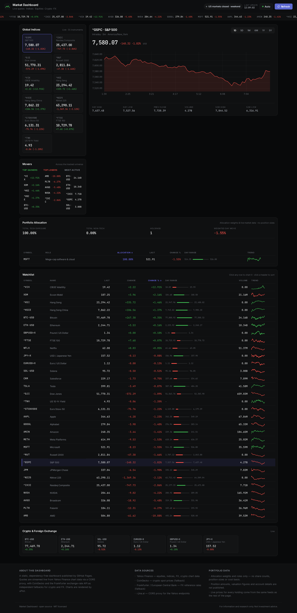
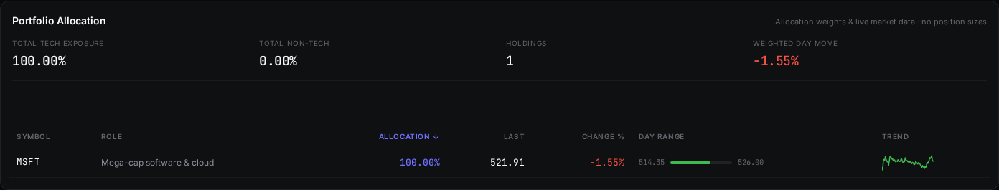

# Market Dashboard

A live stock-market dashboard published with GitHub Pages. No build step, no
framework, no bundler — plain HTML, CSS and one vendored chart library.

**Live URL:** https://dorapwn.github.io/market-dashboard/





## What it shows

- **Portfolio allocation** — the actual holding with its allocation weight,
  role, live price, day change and intraday sparkline; tech vs non-tech
  exposure, holding count and weighted day move. Click any row to chart it.
- **Global indices** — S&P 500, Nasdaq, Dow, Russell 2000, VIX, Hang Seng,
  Nikkei 225, Euro Stoxx 50, FTSE 100, US 10-year yield
- **Watchlist** — every tracked instrument (indices, large-cap equities,
  crypto and FX) with last price, change, day range bar, volume and an
  intraday sparkline; sortable by any column
- **Movers** — top gainers, top losers and most-active names
- **Crypto & FX** — Bitcoin, Ethereum, Solana, EUR/USD, GBP/USD, USD/JPY
- **Interactive chart** — 1D / 5D / 1M / 6M / 1Y / 5Y ranges for any symbol,
  clickable from an index card, a watchlist row, a mover or a crypto card
- **Ticker rail** — a scrolling marquee of every tracked instrument
- **Market status** — open / pre-market / after-hours / closed, in US Eastern

The page refreshes itself every 60 seconds. The `Auto` button pauses that.

## Portfolio data and what is deliberately not published

The portfolio section reflects the **actual** holdings — a single position —
rather than a hypothetical plan.

**Published** — ticker symbols, allocation weights (percentages), a short
role label per holding, sector buckets, and live market data for each ticker.

**Never published** — share counts, absolute dollar amounts, total portfolio
value, cost basis, broker, tax or account details, and personal decision
rules or watchlist rationale.

Allocation weights are ratios, so the exact position size is not inferable
from anything in this repository. The values in `assets/portfolio.js` are a
public-safe projection of the real holdings.

Do not add the excluded details to `assets/portfolio.js`, `data/snapshot.json`,
the README or the footer. The exclusion list is restated in the header comment
of `assets/portfolio.js` so it survives future edits.

Two gates enforce this, and both are tested:

- `assets/portfolio-model.js` defines the exact key set a published holding
  may carry. `validate()` rejects a sensitive field by *name*, which is
  stronger than matching values — a share count of `100` is caught even
  though it looks like a harmless number.
- The deploy workflow re-runs that validation on every push, and greps the
  published files for currency amounts.

`test/gate-check.sh` proves both directions of the gate: the clean tree
passes, and a synthetic leak is blocked.

## Data sources

| Source | Used for | CORS from a browser? |
|---|---|---|
| Yahoo Finance `chart` + `spark` | equities, indices, FX, crypto chart data | **No** — needs a proxy |
| [r.jina.ai](https://r.jina.ai/) | CORS proxy in front of the Yahoo endpoints | Yes |
| [CoinGecko](https://www.coingecko.com/en/api) | crypto spot prices (fallback) | Yes (`ACAO: *`) |
| [Frankfurter](https://frankfurter.dev/) | ECB FX reference rates (fallback) | Yes (`ACAO: *`) |

### Why a proxy is required

Yahoo's chart endpoints return no `Access-Control-Allow-Origin` header:

```console
$ curl -sI -H 'Origin: https://example.com' \
    'https://query1.finance.yahoo.com/v8/finance/chart/AAPL?range=1d&interval=5m' \
  | grep -i access-control
# (no output — no CORS header)
```

A browser therefore cannot call Yahoo directly from a static GitHub Pages
page. `r.jina.ai` re-serves the same URL with a correct `ACAO` header, which is
what makes a dependency-free static dashboard possible. The `x-respond-with:
text` header makes it return the raw JSON body instead of a markdown envelope.

The proxy is a third-party service and a single point of failure. If it is
down or rate-limited, the page falls back to the last committed snapshot.

## Fallback behaviour

`data/snapshot.json` holds the last successful quote set and is refreshed
every 30 minutes by the `Refresh market snapshot` workflow. When every live
feed fails, the page loads that snapshot and marks the header **"Stale
snapshot"** in red, so stale numbers are never presented as live.

The snapshot also stores each instrument's intraday close series, so the
stale view still draws working sparklines and a chart instead of an empty
panel. The snapshot stores closes but not timestamps, so the chart's time
axis is reconstructed backwards from the quote's market time.

## Local development

```bash
# serve the site (any static server works)
python3 -m http.server 8765

# open http://127.0.0.1:8765/

# run the unit tests
npm test

# prove the tests catch the bugs they claim to (mutation check)
npm run mutation-check

# prove the CI leak gate blocks a synthetic leak
./test/gate-check.sh

# regenerate the offline snapshot
node scripts/make-snapshot.js
```

There is no build and no dependency install — `assets/vendor/uPlot.min.js` is
committed so the page works offline and cannot break because of a CDN. The
tests use Node's built-in test runner, so there is nothing to install
either.

## Project layout

```
index.html                 page shell
assets/style.css           design system (dark, Linear-inspired)
assets/app.js              data layer + rendering + chart wiring
assets/portfolio-model.js  pure portfolio logic (tested, shared with CI)
assets/portfolio.js        public-safe portfolio allocation (weights only)
assets/vendor/uPlot.min.js vendored chart library (MIT)
scripts/make-snapshot.js   writes data/snapshot.json
data/snapshot.json         last known good quotes + close series
test/
  portfolio-model.test.js  unit tests (node --test)
  mutation-check.sh        proves the tests detect injected bugs
  gate-check.sh            proves the CI leak gate blocks real leaks
.github/workflows/
  deploy.yml               Pages deployment + asset/JSON/JS checks
  refresh-snapshot.yml     scheduled snapshot refresh
```

## Implementation notes

Things that are easy to get wrong and are worth knowing if you edit this:

- **Yahoo's `spark` endpoint caps at 20 symbols per request.** More than 20
  returns `400 Bad Request: Number of symbols needs to be less than or equal
  to 20`. The client splits the universe into chunks of 20 and merges them.
- **The chart symbol must be a URL path segment**, not a query parameter:
  `/v8/finance/chart/AAPL`, not `/v8/finance/chart?symbol=AAPL`. The latter
  returns `404 Not Found`.
- **uPlot's data format is `[[xValues[]], [yValues[]]]`** — two parallel
  arrays. Passing an array of `{x, y}` objects silently renders an empty
  canvas with no error, which is very hard to debug from the outside.
- **A uPlot time axis expects UNIX seconds**, not milliseconds.
- **`uPlot.fmtDate` is a factory**: `uPlot.fmtDate('{h}:{mm}')` returns a
  formatter function. Calling it with a `Date` returns garbage labels.
- **uPlot draws on a deferred tick.** Reading the canvas immediately after
  construction shows zero pixels; measure after a tick, or call
  `u.redraw(true, true)`.

## Licence

MIT. The dashboard is for information and research only — not investment
advice.
